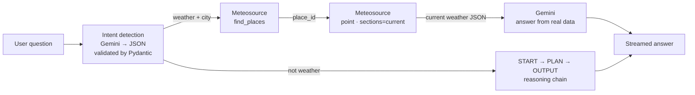

# Weather Agent

A small command-line AI agent that answers questions about the weather with **real data**.

You ask in plain language, for example *"What's the weather like in Dhaka right now?"*. The agent:

1. Uses **Gemini 2.5 Flash** to decide whether the question is about the weather and which city it is about (intent detection).
2. Calls the **Meteosource** API:
   - `find_places` turns the city name into a `place_id`
   - `point` (`sections=current`, `units=metric`) returns the current weather: temperature, summary, wind, humidity and cloud cover
3. Sends the real weather data back to the LLM, which **streams** a short, natural answer.

Questions that are not about the weather go through a simple *START → PLAN → OUTPUT* reasoning chain instead.

Every LLM response is requested as JSON. It is streamed to the terminal, stripped of markdown code fences and validated with **Pydantic**.

## Flow



Plain-text version:

```
user ──▶ intent detection (LLM) ──▶ Meteosource find_places ──▶ Meteosource point (current)
                                                                         │
streamed answer ◀──────────────── LLM (answers from the weather data) ◀──┘
```

## Error handling

The agent prints a clear message and does not crash when:

| Situation | Message |
|---|---|
| `METEOSOURCE_API_KEY` is missing | Weather service is not configured |
| `GOOGLE_API_KEY` is missing | GOOGLE_API_KEY is not set |
| City not found | Could not find a city called '…' |
| Invalid API key (HTTP 401/403) | The weather service rejected the API key |
| Rate limit (HTTP 429) | Weather API rate limit reached |
| Timeout or network error | The weather service took too long / could not be reached |
| LLM returns invalid JSON | Shows the raw output instead of crashing |

## Setup

Requirements: Python 3.10+, a [Google Gemini API key](https://aistudio.google.com/apikey) and a free [Meteosource API key](https://www.meteosource.com/client/sign-up).

```bash
pip install openai requests python-dotenv pydantic
cp .env.example .env   # then put your keys in .env
```

`.env.example`:

```
GOOGLE_API_KEY=your_gemini_api_key_here
METEOSOURCE_API_KEY=your_meteosource_api_key_here
PREFERRED_COUNTRY=Bangladesh
```

API keys are only read from `.env`. They are never written in the code, and `.env` is git-ignored.

## Run

```bash
python main.py
```

Example:

```
👉 What's the weather in Dhaka?
...
OUTPUT: It's currently 27 °C and partly sunny in Dhaka, Bangladesh, with a light wind from the south at 2 m/s.
```
